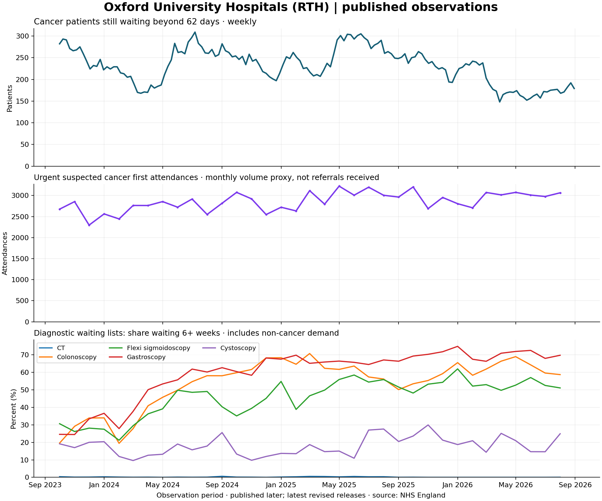

# Cancer Clock

We are building a hospital-level planning tool for cancer backlogs: forecast
whether queues will grow, show evidence of diagnostic or treatment pressure,
and compare recovery scenarios with the assumptions visible.

**Current build: Stage 1, real-data pipeline.** The repository includes cleaned
NHS observations and an Oxford chart. There is no forecast, simulator or website
yet. Model accuracy and intervention benefit have not been measured.

Planning information, not medical advice. No personal waiting-time predictions.

## Run on your Mac

Use Python 3.12. The earlier Stage 0 environment can be reused. From inside
`cancer-clock/`:

```sh
.venv/bin/python -m pip install -r requirements.txt
.venv/bin/python -m pytest -q
.venv/bin/python -m pipeline.check
open docs/fig_rth_backlog.png
```

If starting on a fresh laptop, first check and create the environment:

```sh
python3.12 --version
python3.12 -m venv .venv
```

If the first command is not found, install Python 3.12 from python.org and reopen
Terminal before continuing. The project requires Python 3.11+; this delivery was
checked on Python 3.12. Dependency versions are pinned in `requirements.txt`.
No API keys are needed.

On Windows, use `py -3.12 -m venv .venv` to create the environment, and replace
`.venv/bin/python` with `.venv\Scripts\python.exe` in the commands. Open the PNG
through File Explorer instead of using `open`.

Expected checks: `14 passed` and `Stage 1 snapshot checks passed`. The latter
checks the included files without accessing the NHS website. Test fixtures are
synthetic parser examples; none is included as observed NHS data.

## Rebuild from NHS sources

```sh
.venv/bin/python -m pipeline.build --end 2026-08
```

One command discovers source links, downloads and caches the selected releases,
parses both old/new CWT formats, aggregates diagnostic records, validates the
counts, writes seven parquet datasets, draws the Oxford chart and attempts to
resolve organisation locations. The first run downloads dozens of files and
may take several minutes depending on your connection. Download progress and
parser messages are printed throughout.

Useful options:

```sh
# Reparse your existing downloads without any network calls:
.venv/bin/python -m pipeline.build --offline --end 2026-08
# A smaller real-data run, useful while debugging:
.venv/bin/python -m pipeline.build --start 2026-06 --end 2026-08 --skip-locations
# Refresh source pages and downloads instead of reusing the cache:
.venv/bin/python -m pipeline.build --end 2026-08 --refresh
# Resolve or retry location lookups separately:
.venv/bin/python -m pipeline.locations
```

A short-range run replaces processed outputs with that shorter range. Run the
full build again before modelling. Offline mode needs a locally completed raw
manifest; the ZIP deliberately excludes raw files. Omitting `--end` discovers
the latest available releases. Only observations from October 2023 onward are
allowed. Later methods must check calendar coverage before choosing origins.

If an NHS request fails, rerun the same command; completed downloads are cached.
If a downloaded file fails its checksum, use `--refresh`. If the site presents a
browser challenge, the downloader stops with an explanation. It does not bypass
access controls. If a source schema changes, the build stops and reports the
unexpected columns. It never substitutes example data. A failed build does not
make any previously generated outputs current.

## What was checked

See [Stage 1 handoff](docs/stage_1.md) for the measured dataset sizes and test
results. `outputs/data_quality.json` contains provider counts by period, missing
months/weeks, appearing/disappearing provider codes, overlap across sources and
provider/national backlog discrepancies. `docs/source_manifest.csv` preserves
the source URL and SHA-256 hash for each selected download.



The middle panel is completed first outpatient attendances, not referrals
received. The bottom panel includes non-cancer diagnostic demand. These panels
are observations with different units; they do not establish the cause of the
backlog.

## Important differences from the initial brief

- October 2023–September 2025 use provider workbooks. October 2025 onward uses
  Combined CSVs. The importer supports both and avoids repeated header rows.
- Older workbook exports can incorrectly declare the sheet range as A1; the
  parser reads the actual sheet rows instead of trusting that declaration.
- Referral-labelled tables measure first attendances. They are a possible
  demand proxy, not a measured arrival stream for a queue simulator.
- One revised March 2025 diagnostic link is labelled March 2026 on its page.
  DM01 months are checked against the filename and CSV Period, and CDC-only
  extracts are excluded.
- Day 14 of the upload month is an assumption. Latest revised data plus assumed
  publication dates are not verified historical vintages. Availability filtering
  requires explicit acknowledgement of that limitation.
- Provider lists include independent providers. The weekly backlog and monthly
  sources have different coverage; the overlap is reported, not invented.

See [data dictionary](docs/data_dictionary.md), [methodology](docs/methodology.md)
and [assumptions](docs/assumptions.md) before using these data in a model.

## GitHub: when and what to commit

Commit and push after each working stage. Keep the same local folder so the
`.git/` history survives updates. The complete Mac instructions, Stage 0 commit,
remote setup and Stage 1 commit are in [GitHub workflow](docs/git_workflow.md).

Stage 1 commit subject:

```text
Add NHS waiting-time data so we can test backlog forecasts against real history
```

The body explains the old/new source formats, Oxford check, approximate release
dates and first-attendance limitation. No files need deleting for this stage.

For web uploads, upload the contents of `cancer-clock/` at the repo root. Include
`.gitignore` and `.env.example`. The supplied ZIP excludes `data/raw/`, `.venv/`,
`node_modules/`, `.env`, `.git/`, caches and build outputs. If uploading your own
working folder, exclude them manually: the web uploader does not enforce ignore
rules. All included processed files are below 25 MB and the archive has fewer
than 100 files. Normal Git commands do respect `.gitignore` for untracked files.

To make another clean archive:

```sh
.venv/bin/python scripts/package_repo.py
```

## Source and code layout

- `config.py`: project name, paths, constants and labelled assumptions.
- `pipeline/`: discovery, downloads, parsers, availability filter, checks, plot,
  location lookups and the single build command.
- `data/raw/`: ignored source/cache files; never committed.
- `data/processed/`: small, reproducible parquet outputs.
- `data/static/`: provider location table; unresolved coordinates remain blank.
- `outputs/data_quality.json`: actual coverage and validation report.
- `tests/`: Stage 0 smoke test plus parser and availability tests.
- `docs/`: definitions, methodology, source manifest, handoff and Git workflow.
- `models/`, `analysis/`, `sim/`, `api/`, `web/`, `integrations/`: reserved for
  later stages; no model or web app is implemented yet.

## Next stages and sponsor plans

Stage 2 builds rolling back-tests and naive baselines before Stage 3 adds ML.
Stage 3 must report model-versus-baseline results honestly and stop for review
if its performance gate is missed. Stages 4–5 add bottleneck evidence and an
assumption-led simulator. Stage 6 is a stretch allocator; Stages 7–8 add the API
and frontend. Stages 9–10 add Gemini, optional Tiger Data and Vultr hosting.
Stage 11 is optional voice/outlook; Stage 12 is submission polish.

HRT is the main proposed track. Gemini, Tiger Data and Vultr are secondary;
ElevenLabs/Delta are optional. Event eligibility must be checked separately.
No sponsor integration or hosting has been implemented yet.

## Sources and attribution

- [NHS England Cancer Waiting Times](https://www.england.nhs.uk/statistics/statistical-work-areas/cancer-waiting-times/monthly-data-and-summaries/)
- [NHS England cancer management information](https://www.england.nhs.uk/statistics/statistical-work-areas/cancer-waiting-times/management-information-on-cancer/)
- [NHS England diagnostics waiting times](https://www.england.nhs.uk/statistics/statistical-work-areas/diagnostics-waiting-times-and-activity/monthly-diagnostics-waiting-times-and-activity/)
- [NHS Organisation Data Service](https://digital.nhs.uk/developer/api-catalogue/organisation-data-service-ord)
- [postcodes.io](https://postcodes.io/)

Contains public sector information licensed under the
[Open Government Licence v3.0](https://www.nationalarchives.gov.uk/doc/open-government-licence/version/3/).
NHS England is the source of the waiting-time statistics; this project is not
endorsed by NHS England. The MIT license covers our code, not third-party data.
Location responses retain their source URLs; see the location providers' terms.

Team: Sanjay and Rounak, as specified in the project brief.
